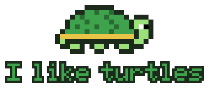

# TurtleMaxxxing

[](https://github.com/jefflovell/TurtleMaxxxing/actions/workflows/ci.yml)

<p align="center">
  
</p>

A free, open-source, **local-first personal assistant and project manager** that keeps work and personal life separate, with AI help only where you allow it.

- 🏠 **Runs locally.** Your data stays on your machine.
- 🔌 **You choose the connectors and the AI:** your own Claude, a fully local model, or another provider.
- 🔒 **Privacy first.** No accounts, no telemetry, nothing in the cloud in our code.
- ✅ **Tasks and reminders** with kanban status, your own labels (star your favorites), a calendar, and the people each task is about.
- 💸 **Budgeting that runs itself:** describe your paychecks, splits, bills and subscriptions once, and the app keeps the ledger moving. Import your bank's CSV to confirm what actually happened.

🚧 **Status:** early. Budgeting, tasks, the calendar, CSV import and contacts are working, with a free installer. AI help comes next.

## Roadmap

| | Milestone | What you get |
|---|---|---|
| ✅ | **M0: Guardrails** | The [security guide](docs/SECURITY.md) and a [separation test](docs/testing/SEPARATION_TEST.md) to check your AI tools can't see your work stuff |
| ✅ | **M1: App + budget** | Accounts, paychecks with splits, bills and subscriptions that post themselves, a cash-flow chart, balance check-ins, the one-paste installer |
| ✅ | **M2: Tasks and people** | Tasks with kanban status, your own labels, lists, reminders, a Today screen, a calendar with tasks and bills, saved filters, bank CSV import, contacts |
| ✅ | **M2.5: Free for everyone** | A double-click installer, updates that roll back if anything fails, and help from a free Claude chat. **No paid accounts needed.** |
| 🔜 | **M3: AI, your way** | Connect your own Claude (the free plan works). Say *"remind me to review the proposal by Friday noon"* and it proposes the task for you to approve. Private items never reach it, and every access is logged. |
| ⬜ | **M4: Connectors** | Read your calendars and bill-alert emails (only the ones you turn on) |
| ⬜ | **M5: Phone** | Use it from your phone over your own private network |
| ⬜ | **M6: Pick your AI** | A chat panel, with fully local models (Ollama) or the provider you choose |
| ⬜ | **M7: Research** | Summarize public documents like building codes and check your notes against them |

After the features are in, the first user tests everything together, and their feedback lands in the [backlog](docs/BACKLOG.md). The full plan, with the reasons behind each choice, is in [PLAN.md](PLAN.md).

## Get it on your computer

**Free, no programming, and no paid accounts.** Download it, unzip it, double-click the installer. About 10 minutes, mostly waiting on downloads.

### What's "the codebase", and do I need a GitHub account?

This page is on **GitHub**, a website where people share the files that make up an app (its *code*). Getting the app means copying those files to your computer. Then the app runs **entirely on your computer**: nothing you put in it ever goes back to GitHub.

**You don't need a GitHub account,** and **you don't need a Claude account** to install or use it. TurtleMaxxxing is public, so anyone can download it without signing in. A free GitHub account is only for [reporting a problem](https://github.com/jefflovell/TurtleMaxxxing/issues) or ⭐ starring the project.

### What you need

- A **personal** Windows 10 or 11 computer. **Never use a work computer.**
- That's it. The installer offers to set up the one free tool the app needs (**uv**, which installs Python for it).

Mac or Linux? The app itself runs there, but the installer is Windows-only for now. See [Install by hand](#install-by-hand-for-the-technical).

### Three steps

1. **Download:** go to the **[latest release](https://github.com/jefflovell/TurtleMaxxxing/releases/latest)** and click **TurtleMaxxxing-*version*.zip** under *Assets*.
2. **Unzip:** right-click the downloaded file → **Extract All…** → **Extract**.
3. **Install:** in the unzipped folder, double-click **Install TurtleMaxxxing**.
   - If Windows says **"Windows protected your PC"**, click **More info** → **Run anyway**. Windows warns about most free apps that don't have a paid signing certificate.
   - Answer its few questions (where to install, your address name, your **personal** browser). It installs everything, **runs the built-in privacy tests**, shows you the results, and opens the app.

From then on, press the **Windows key**, type **I like turtles**, and press **Enter**. 🐢

The **[full install guide](docs/INSTALL.md)** has every screen explained, plus what to do if something's missing, and how to uninstall.

### Later: updates and help
- **Update:** Start menu → **TurtleMaxxxing** → **Update TurtleMaxxxing**. It checks the download's fingerprint, re-runs the tests, keeps your data, and **puts your old version back automatically if anything fails**.
- **Something wrong?** Start menu → **TurtleMaxxxing** → **Check my TurtleMaxxxing install** makes a short report with no data from the app. Then follow the [troubleshooting guides](docs/troubleshooting/README.md), or paste the report and the [help prompt](docs/HELP_PROMPT.md) into a **free** Claude chat.
- **Safety check:** after installing, the 15-minute [separation test](docs/testing/SEPARATION_TEST.md) confirms your AI tools can't see your work stuff. The [security guide](docs/SECURITY.md) explains it all in plain language.

### Have a paid Claude plan? (optional)
If you have **Claude Code** (included in Claude's [paid plans](https://claude.com/pricing)), the [one-paste setup prompt](docs/SETUP_PROMPT.md) has Claude do the install for you, explaining each step. Afterwards, open your TurtleMaxxxing folder in Claude Code and say what you want: **"update TurtleMaxxxing"**, **"the page is blank"**, or **"backlog: …"** to request a change.

## Install by hand (for the technical)

You need [Git](https://git-scm.com/), [uv](https://docs.astral.sh/uv/) and [Node.js](https://nodejs.org/) (LTS). Then:

```bash
git clone https://github.com/jefflovell/TurtleMaxxxing.git
cd TurtleMaxxxing
uv sync --directory backend
npm install --prefix frontend
npm run build --prefix frontend
uv run --directory backend turtlemaxxxing
```

Then open **http://turtle.localhost:8765**. Your data stays in your local app-data folder, and the app only listens on your own computer.

Just looking? `uv run --directory backend turtlemaxxxing --demo` runs it with fictional data in a throwaway folder.

No Git? The green **Code** button at the top of this page → **Download ZIP** works too. Unzip it, open a terminal in the `TurtleMaxxxing-main` folder, and start from the `uv sync` line. Updating then means downloading the ZIP again, so Git is easier in the long run.

🧪 **Trust, but verify:** every privacy promise has a test you can run yourself. See the [testing SOP](docs/TESTING.md). For AI agents working on the code, start with [AGENTS.md](AGENTS.md).

I like turtles. 🐢

## License

[MIT](LICENSE)
